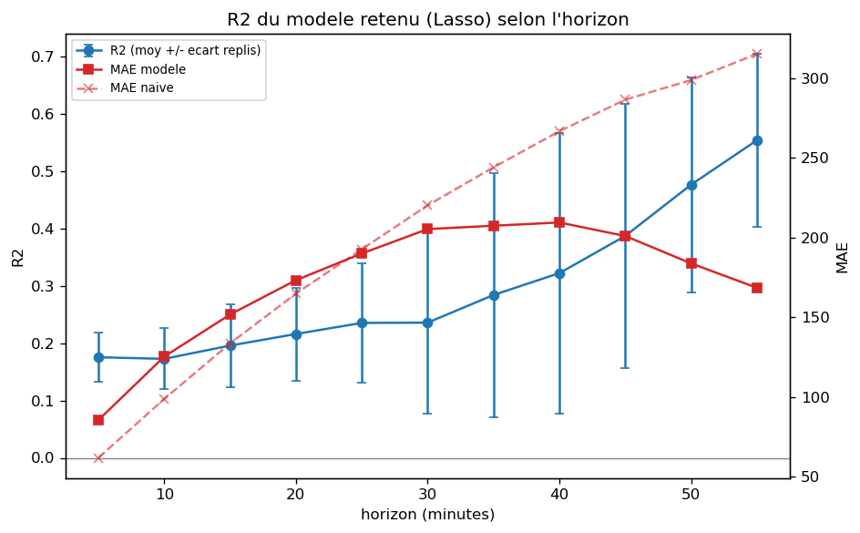
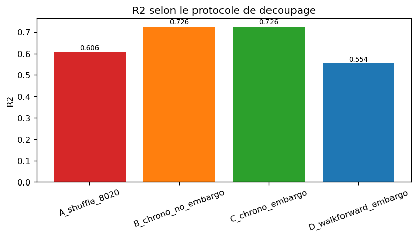
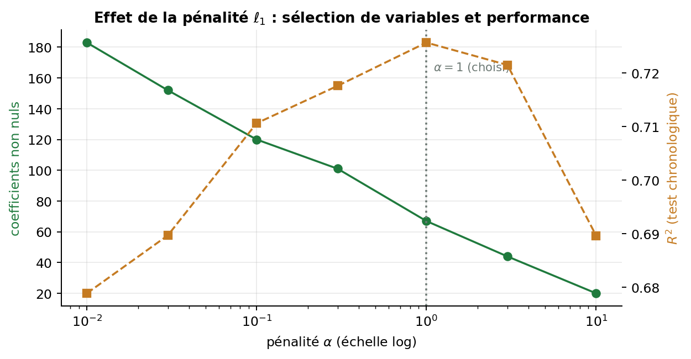
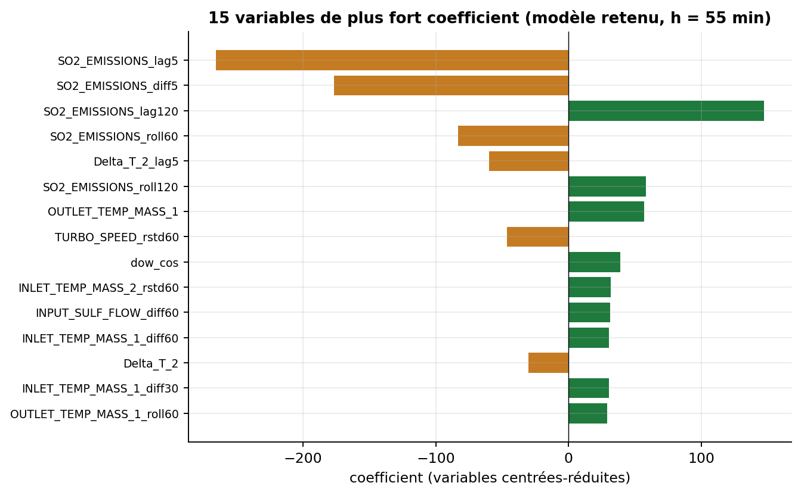

# SO₂ Emissions Forecasting — Industrial Time Series (Sulfuric Acid Unit)

Forecasting SO₂ emissions **55 minutes ahead** from minute-level process sensors of a sulfuric acid production line,
then testing whether any process variable can be used as a **control lever** to reduce emissions (simulated MPC controller).

> Built during my 2026 summer internship (OCP Group, Jorf Lasfar).
> The industrial data is **confidential and not included**. The repository ships a **synthetic data generator**
> with the same schema, so the full pipeline runs end-to-end on any machine.

---

## Results (on the real industrial dataset)

| | |
|---|---|
| Data | 35,260 one-minute readings, 12 sensors, 24 days |
| Cleaning | 7.8 % rows removed (disguised fault codes + physical bounds), 134 continuous blocks |
| Features | 263 engineered features (lags, rolling mean/std, differences, temperature deltas, time-of-day) |
| Model | **Lasso** linear regression, walk-forward validation (5 expanding folds + embargo) |
| Forecast skill (h = 55 min) | **R² = 0.55 ± 0.15** (best fold 0.73), **MAE −47 %** vs naive forecast |
| Leakage checks | 4 split protocols compared + negative control (shuffled target → R² ≈ 0 ✔) |
| Control levers | 8 candidates tested (including the four catalytic-bed inlet temperatures) → **1 validated** (`TEMP_FOUR`, weak: ≈ 1.2 ppm/°C); `TURBO_SPEED` found bimodal (on/off); `INLET_TEMP_MASS_2` is by far the most sensitive (≈ +14 ppm/°C) but is excluded narrowly by the bimodality test → a lead to confirm with plant operations |
| MPC simulation | Run with perfect knowledge of the observed future (an **upper bound**). `TEMP_FOUR` alone cuts cumulative exceedance by ≈ 38 % at the P75 threshold but needs unrealistic moves and does not reduce the number of minutes above the threshold; the 8-lever version (≈ −80 %) is only a theoretical bound |

The last two lines are a **cautious result, reported honestly**: the model forecasts well, but no strong, reliable, continuously
adjustable lever was validated among the available signals. This avoided a misleading recommendation to the plant.

<p align="center">
  
  
</p>
<p align="center">
  
  
</p>

---

## Method

```
raw CSV ─► audit ─► cleaning ─► continuous blocks ─► feasibility grid ─► features (per block)
        ─► target = SO₂[t+h] − SO₂[t] ─► OLS vs Lasso (walk-forward) ─► horizon sweep
        ─► leakage tests ─► final model
        ─► Phase 2: lever sensitivity (analytic vs empirical) ─► bimodality test ─► MPC simulation
```

Key design choices:

- **No imputation.** Fault codes disguised as measurements (e.g. `-999.9`) are detected automatically
  (value repeated ≥ 50 times *and* violating a physical bound), set to NaN, then the rows are dropped.
- **Features are computed inside continuous blocks**, so no lag ever crosses a data gap.
- **Predict the variation, not the level**: the level is dominated by persistence; the variation is what an operator needs.
- **Walk-forward validation with an embargo** (lookback + horizon) between train and test, to prevent temporal leakage.
- **Lasso instead of plain OLS**: with 263 highly collinear features, OLS is unstable across folds (R² std ±0.47);
  L1 regularisation keeps ~67 informative features and stabilises the model.
- **Every parameter lives in `config.yaml`**; the code contains no hard-coded value.

## Repository structure

| File | Role |
|---|---|
| `config.yaml` | all parameters (cleaning, features, validation, Phase 2) |
| `so2lib.py` | all functions (loading, cleaning, features, validation, leakage tests, levers, MPC) |
| `phase1_prevision.py` | Phase 1 — forecasting pipeline |
| `phase1b_modeles.py` | model comparison: OLS / Ridge / Lasso / ElasticNet × feature sets × validation settings |
| `phase2_leviers_mpc.py` | Phase 2 — lever validation + simulated MPC controller |
| `figures.py` | regenerates all figures from saved results |
| `build_notebooks.py` | converts the `# %%` scripts into Jupyter notebooks |
| `make_synthetic_data.py` | generates a synthetic dataset with the same schema as the real one |

## Quick start

```bash
pip install -r requirements.txt
python make_synthetic_data.py      # -> data/synthetic_so2.csv
python phase1_prevision.py         # forecasting  (outputs/ + outputs/figures/)
python phase2_leviers_mpc.py       # levers + MPC
python phase1b_modeles.py          # optional: model comparison (slower)
```

Prefer notebooks? `python build_notebooks.py` then open `01_phase1_prevision.ipynb`.

> Numbers obtained on synthetic data differ from the table above: the generator only reproduces the *structure*
> of the real data (gaps, fault codes, autocorrelation, bimodal turbine), not its exact behaviour.

## Tech stack

Python · pandas · NumPy · scikit-learn · SciPy · Matplotlib · PyYAML · Jupyter

## Author

**Sara Bakhori** — Software Engineering & Digitalisation student, ENSEM Casablanca
[LinkedIn](https://www.linkedin.com/in/sara-bakhori-64b938337) 
